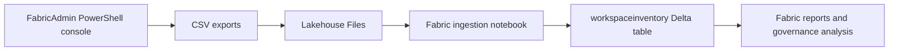

# Lakehouse Architecture

## Data Flow

FabricAdmin reads Power BI service metadata using the signed-in administrator's permissions. It writes CSV files to the repository's `exports/` directory by default. Exports are local artifacts and are intentionally excluded from Git because they can contain tenant identifiers and user information.

For workspace ingestion, copy `PowerBI_Workspaces.csv` to `Files/fabric-admin/PowerBI_Workspaces.csv` in the Lakehouse. Run `notebooks/FabricAdmin_Ingestion.py` from a notebook attached to that Lakehouse. The notebook upserts records into `workspaceinventory` using `Id` as the key. It updates and inserts rows but does not remove workspaces missing from a later snapshot; consumers should use an explicit snapshot strategy if historical state or deletion reconciliation is required.

Refresh-health, gateway, datasource, and permissions exports are produced by their corresponding console actions. The workspace ingestion notebook currently handles the workspace inventory only. No cloud credentials or service-principal secrets are stored in this repository.

## Automation Boundary

`.github/workflows/fabric-admin.yml` validates source syntax only. It does not authenticate to Power BI/Fabric, generate tenant exports, or write to OneLake. Schedule or deployment automation requires a separately reviewed non-interactive identity and secret-management design.